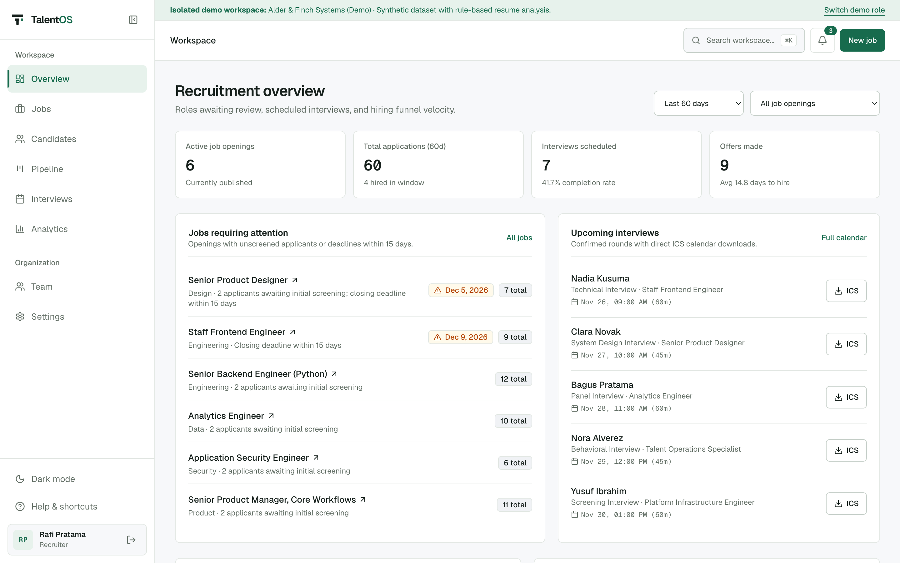
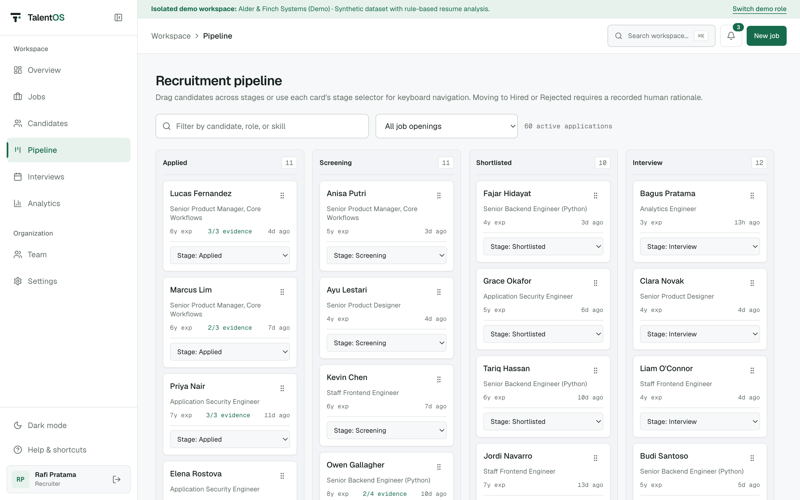
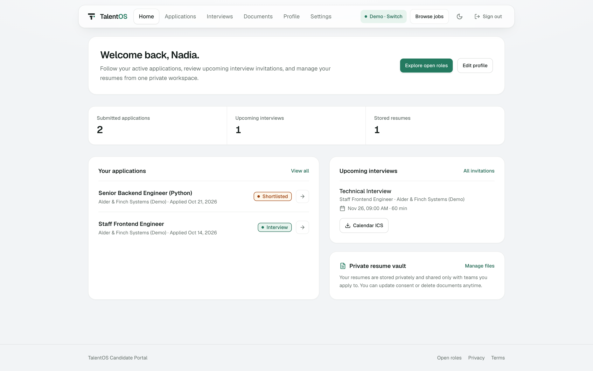
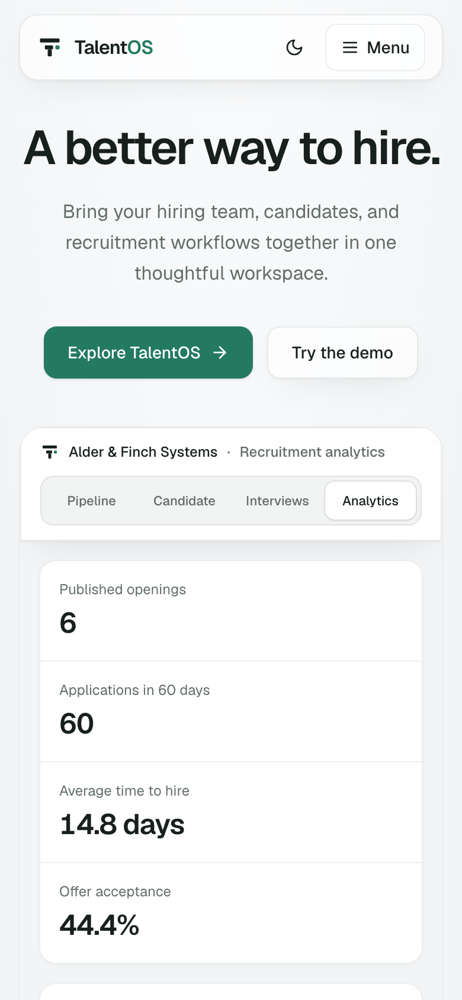
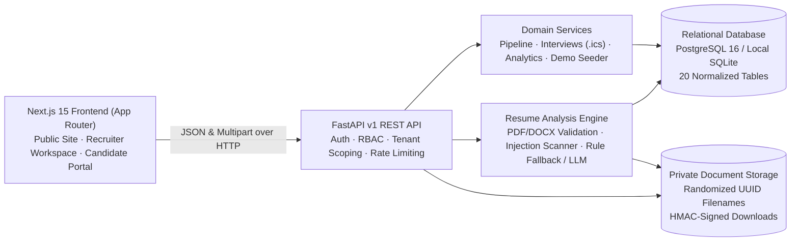

<p align="center">
  
</p>

# TalentOS

**A better way to hire.**

Bring your hiring team, candidates, and recruitment workflows together in one thoughtful workspace.

TalentOS is a full-stack recruitment operating system built as an independent software engineering portfolio project by [Dandi Setiawan](https://www.dandisetiawan.id/). Designed around an operating-system-inspired Liquid Glass interface, it unifies a public product website and live careers board, an organization-isolated recruiter workspace, and a dedicated candidate portal backed by a normalized relational schema and evidence-first resume analysis.

> **Portfolio notice:** TalentOS is an independent software project, not a commercial vendor. All demonstration organizations, job openings, candidates, and resumes are synthetic and contain zero real personal data.

---

## Application Previews

All screenshots below were captured directly from the running TalentOS production build.

### Public Website and Recruiter Overview
| Public Landing Page | Recruiter Overview (Light Mode) |
|---|---|
|  |  |

### Dark Mode and Hiring Pipeline
| Recruiter Workspace (Dark Mode) | 7-Stage Hiring Pipeline |
|---|---|
|  |  |

### Candidate Dossier and Resume Insights
| Evidence-Based Resume Insights | Candidate Profile and Documents |
|---|---|
|  |  |

### Jobs, Interviews, Analytics, and Candidate Portal
| Job Openings | Interview Coordination Calendar |
|---|---|
|  |  |

| Recruitment Analytics | Candidate Portal |
|---|---|
|  |  |

<details>
  <summary>View mobile responsive preview (390px)</summary>
  <br />
  
</details>

---

## Core Functionality

- **Liquid Glass workspace shell**: Floating collapsible sidebar with organization switcher, unified translucent toolbar, Spotlight command center (`Cmd` or `Ctrl + K`) with recent actions and live job and candidate search, and an interactive notification center popover.
- **Three connected surfaces**: Public product website and live careers board (`/` and `/careers`), recruiter workspace (`/workspace/*`), and an approachable candidate portal (`/candidate/*`).
- **Role-based access control and tenant isolation**: `organization_owner`, `recruiter`, `hiring_manager`, and `candidate` boundaries enforced on every FastAPI route and database query.
- **Job architecture**: Draft, publish, pause, or close roles with required and preferred qualifications, skills, compensation bands, and closing dates. Published roles appear immediately on `/careers`.
- **Candidate dossiers**: Searchable directory, skill and stage filtering, editorial candidate dossiers, expiring HMAC-signed document downloads, and private recruiter notes strictly hidden from candidates.
- **Accessible 7-stage hiring pipeline**: Pointer drag-and-drop via `dnd-kit` paired with keyboard stage selectors, optimistic state updates with rollback on failure, and mandatory human rationale before moving candidates to `Hired` or `Rejected`.
- **Evidence-first resume insights**: PDF (`PyMuPDF`) and DOCX (`python-docx`) validation and text extraction, prompt-injection scanning, verbatim resume excerpts mapped to published job criteria, built-in deterministic rule-based review requiring no API key, and human reviewer sign-off.
- **Desktop-style interview calendar**: Agenda, week, and month views with date navigation, local timezone consistency, automatic interviewer and candidate conflict checks, structured rubric feedback, and downloadable RFC 5545 `.ics` calendar invitations.
- **Recruitment analytics**: Funnel distribution, conversion rates, daily submission trends, time to hire, stage dwell times, department summaries, metric definitions, and CSV export.
- **Responsive design and themes**: Verified WCAG AA contrast across light and dark modes, container-queried responsive tables, native HTML `<dialog>` overlays and mobile drawers, and `prefers-reduced-motion` support.

---

## Technology Stack

- **Frontend (`apps/web`, `packages/ui`, `packages/contracts`)**: Next.js 15 (App Router), React 19, strict TypeScript, Tailwind CSS v4, Radix UI, Motion, Lucide icons, TanStack Query, React Hook Form, Zod, Recharts, dnd-kit, self-hosted Geist and Geist Mono.
- **Backend (`apps/api`)**: Python 3.12, FastAPI, Pydantic v2, SQLAlchemy 2.0, Alembic, Argon2id (`argon2-cffi`), PyJWT, PyMuPDF, python-docx.
- **Database (`database/`)**: Normalized 20-table relational schema targeting PostgreSQL 16 (Docker Compose, GitHub Actions CI, and Supabase reference RLS SQL) with a zero-Docker local SQLite runtime (`PRAGMA foreign_keys=ON`).
- **Testing and CI**: pytest, Ruff, Vitest, React Testing Library, Playwright, Docker Compose, GitHub Actions (`.github/workflows/ci.yml`).

---

## System Architecture



### Repository Structure

```text
TalentOS/
├── apps/
│   ├── web/              # Next.js 15 App Router frontend (29 routes)
│   └── api/              # FastAPI v1 REST API and domain services
├── packages/
│   ├── ui/               # Shared accessible UI primitives and brand components
│   ├── contracts/        # Shared TypeScript interfaces and Zod schemas
│   └── config/           # Shared strict TypeScript base configuration
├── database/
│   ├── migrations/       # Alembic migrations and Supabase PostgreSQL RLS SQL
│   └── seeds/            # Synthetic public showcase CLI seeder
├── assets/
│   ├── branding/         # Brand mark, wordmarks, favicon, OG image, GitHub banner
│   └── screenshots/      # Production-build application screenshots
├── docs/                 # Technical architecture, ERD, API, AI, security, design docs
└── scripts/              # Local development startup helper
```

Detailed engineering documentation is available in [`docs/`](docs/):
- [Architecture](docs/ARCHITECTURE.md)
- [Database Schema and ERD](docs/DATABASE.md)
- [API Reference](docs/API.md)
- [AI Resume Intelligence](docs/AI_SYSTEM.md)
- [Security Engineering](docs/SECURITY.md)
- [Privacy and Governance](docs/PRIVACY.md)
- [Design System](docs/DESIGN_SYSTEM.md)
- [Interactive Demo Guide](docs/DEMO.md)
- [Testing Strategy](docs/TESTING.md)
- [Deployment Guide](docs/DEPLOYMENT.md)
- [Roadmap](docs/ROADMAP.md)

---

## Database Architecture

TalentOS models recruitment operations across 20 normalized SQLAlchemy tables managed with Alembic migrations ([`database/migrations/versions/ffc1ded51bde_initial_schema.py`](database/migrations/versions/ffc1ded51bde_initial_schema.py)):

- **Identity and Tenancy**: `organizations`, `users`, `organization_members`, `refresh_tokens`, `user_preferences`, `candidate_profiles`.
- **Jobs and Candidates**: `jobs`, `candidates`, `candidate_skills`, `applications`, `application_stage_history`, `recruiter_notes`.
- **Documents and Intelligence**: `candidate_documents`, `resume_analyses`.
- **Interviews and Governance**: `interviews`, `interview_participants`, `interview_feedback`, `notifications`, `activity_logs`, `demo_sessions`.

Every organization-scoped query filters explicitly by `organization_id`. Reference PostgreSQL Row-Level Security policies for managed Postgres deployments are included in [`database/migrations/supabase_rls.sql`](database/migrations/supabase_rls.sql).

---

## AI Provider Architecture

Resume qualification review uses a provider-independent interface (`apps/api/app/services/resume_ai.py`) built around strict responsible-AI boundaries:

- **Default built-in engine (`DeterministicRuleProvider`)**: Runs locally with zero external API credentials, extracting structured summaries, skills, and verbatim evidence sentences matched to published job criteria.
- **Optional external providers**: Configurable via environment variables for OpenAI-compatible endpoints, Google Gemini, or local Ollama models with strict JSON schema validation and automatic deterministic fallback on failure.
- **Prompt-injection defense**: Uploaded PDF and DOCX files are parsed as untrusted input and scanned for embedded override directives before analysis; detected directives are ignored and surfaced to human reviewers.
- **Human decision boundary**: TalentOS never automatically rejects, shortlists, or moves candidates to `Hired` or `Rejected`, and never infers demographics, personality scores, or black-box employability scores.

---

## Security Considerations

- **Authentication**: Argon2id password hashing, short-lived JWT access tokens, and SHA-256-hashed rotating refresh tokens.
- **Authorization and isolation**: Server-enforced RBAC across `organization_owner`, `recruiter`, `hiring_manager`, and `candidate` roles; internal recruiter notes and evaluations are never exposed on candidate endpoints.
- **Upload security**: Strict PDF and DOCX validation checking file extension, MIME type, file signature (magic bytes), archive structure, and 5 MB limit, stored outside public web paths with randomized UUID filenames and expiring HMAC-signed download URLs.
- **HTTP protections**: Content Security Policy, `X-Frame-Options: DENY`, `X-Content-Type-Options: nosniff`, explicit CORS origins, and sliding-window rate limiting.
- **Scope notice**: TalentOS is an independent portfolio project and does not claim formal third-party security or regulatory compliance certification.

---

## Testing and CI Configuration

Continuous integration is configured in [`.github/workflows/ci.yml`](.github/workflows/ci.yml) on every push and pull request to `main`:

- **Backend job (FastAPI + PostgreSQL 16 service container)**: Runs `ruff check`, applies `alembic upgrade head` against PostgreSQL 16, and executes the `pytest` integration suite covering authentication, RBAC, tenant isolation, resume upload validation, prompt-injection detection, interview conflicts, ICS export, and analytics calculations.
- **Frontend job (Node 22 + pnpm)**: Runs strict TypeScript checks (`pnpm typecheck`), ESLint (`pnpm lint`), Vitest + React Testing Library unit tests (`pnpm test:web`), and production `next build` (`pnpm build`).
- **End-to-end smoke spec**: Playwright critical-flow tests live in [`apps/web/tests/e2e/smoke.spec.ts`](apps/web/tests/e2e/smoke.spec.ts).

---

## Local Installation

### Prerequisites

- Node.js 20+ and `pnpm` 12+
- Python 3.12 (`uv` or `venv`)
- Optional: Docker and Docker Compose for containerized PostgreSQL 16

### Setup Steps

1. Clone the repository and copy environment templates:
   ```bash
   git clone https://github.com/dandisetiawanco/TalentOS.git
   cd TalentOS
   cp .env.example .env
   cp apps/web/.env.example apps/web/.env.local
   ```

2. Install frontend workspace dependencies:
   ```bash
   pnpm install
   ```

3. Create the Python virtual environment and install backend packages:
   ```bash
   cd apps/api
   uv venv --python 3.12 .venv
   uv pip install --python .venv/bin/python -e ".[dev]"
   cd ../..
   ```

4. Apply database migrations and seed the synthetic showcase organization:
   ```bash
   pnpm db:migrate
   pnpm db:seed
   ```

5. Start both services (in two terminals, or run `./scripts/dev.sh`):
   ```bash
   pnpm dev:api
   pnpm dev:web
   ```

6. Open locally:
   - Web application: `http://localhost:3000`
   - FastAPI OpenAPI docs: `http://localhost:8000/api/v1/docs`

### Docker Compose (PostgreSQL + API + Web)

```bash
cp .env.example .env
docker compose up --build
```

---

## Demo Instructions

Visit `http://localhost:3000/demo` to start an isolated sandbox as a **Recruiter**, **Hiring Manager**, or **Candidate**.

- Each launch provisions a dedicated synthetic organization cloned from **Alder & Finch Systems (Demo)**: 8 job openings, 40 candidates, 60 applications across 7 stages, 12 interviews, and generated PDF resumes.
- Changes made inside a demo session remain strictly isolated to that visitor's organization.
- Demo sessions run built-in rule-based resume analysis locally so every workflow operates without external API credentials.

---

## Known Limitations

- **Local default database**: Local development without Docker runs on SQLite (`PRAGMA foreign_keys=ON`); PostgreSQL 16 migrations and tests are configured via Docker Compose and GitHub Actions CI.
- **Calendar synchronization**: Interview invites use downloadable RFC 5545 `.ics` files rather than two-way Google Calendar or Microsoft Outlook OAuth sync.
- **Email dispatch**: Notifications persist in-app by default; outbound email delivery is inactive until SMTP settings are configured by an operator.
- **Deployment status**: TalentOS is not hosted on paid external infrastructure in this repository; see [`docs/DEPLOYMENT.md`](docs/DEPLOYMENT.md) for container and cloud deployment blueprints.

---

## Deployment Roadmap

Planned post-v1.0.0 enhancements are documented in [`docs/ROADMAP.md`](docs/ROADMAP.md), including:

- Transactional SMTP and Resend email adapters for candidate status and interview notifications.
- Direct object-storage upload adapters (Supabase Storage or S3-compatible buckets) with scheduled retention cleanup jobs.
- Optional OAuth calendar free-busy lookups alongside downloadable `.ics` invitations.
- Multi-organization switching for recruiters participating across multiple workspaces.

---

## Author

Designed and developed by **Dandi Setiawan** ([www.dandisetiawan.id](https://www.dandisetiawan.id/)).

This repository is published as a personal software engineering portfolio showcase. All rights remain reserved by the author.
