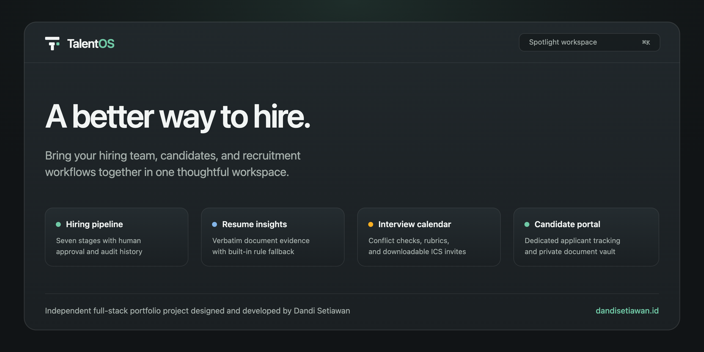
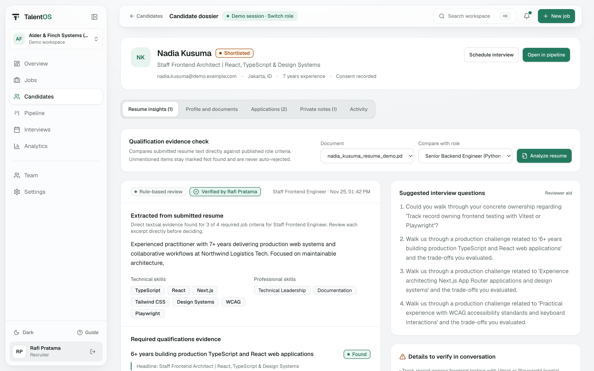
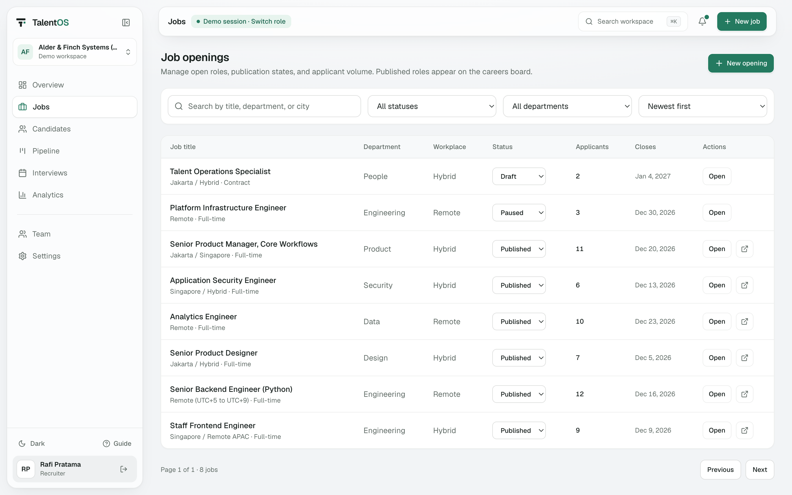
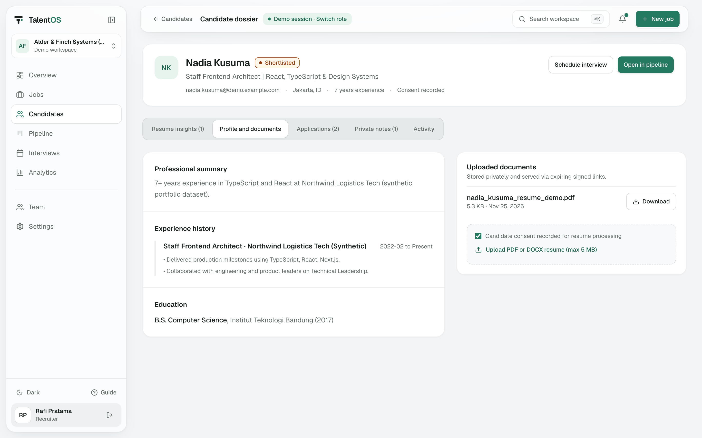
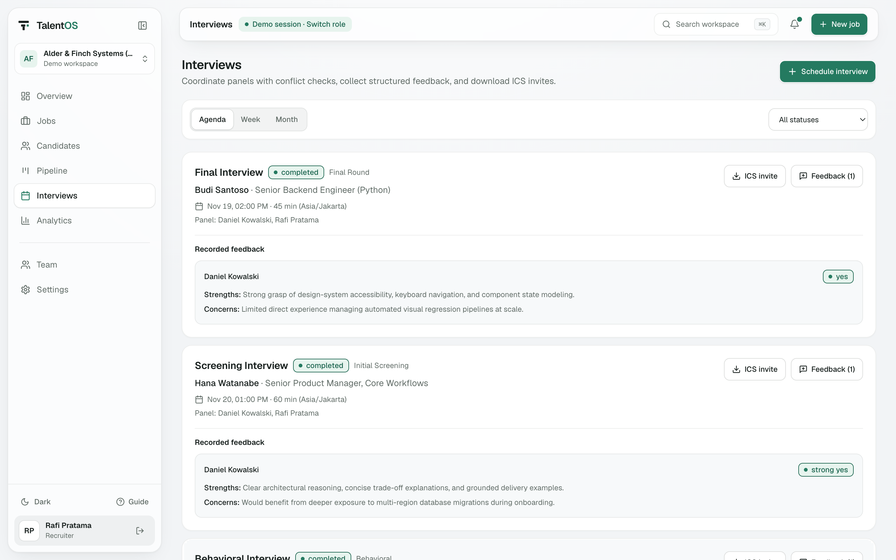
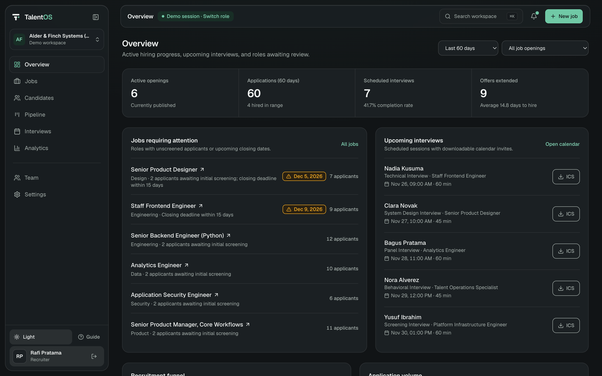

<p align="center">
  
</p>

# TalentOS

**A better way to hire.**

Bring your hiring team, candidates, and recruitment workflows together in one thoughtful workspace.

TalentOS is a full-stack recruitment management platform built as an independent software engineering portfolio project by [Dandi Setiawan](https://dandisetiawan.id). Designed around an operating-system-inspired Liquid Glass interface, it unifies a public product site and live careers board, an organization-isolated recruiter workspace, and a dedicated candidate portal backed by a relational schema and evidence-first resume review.

> **Portfolio notice:** TalentOS is an independent software project, not a commercial vendor. All demonstration organizations, job openings, candidates, and resumes are synthetic and contain zero real personal data.

---

## Application Screenshots

All screenshots below were captured directly from the running TalentOS production build.

### Public Landing Page & Recruiter Overview
| Public Landing Page | Recruiter Overview |
|---|---|
|  |  |

### Hiring Pipeline & Resume Insights
| Kanban Hiring Pipeline | Evidence-Based Resume Insights |
|---|---|
|  |  |

### Job Openings & Candidate Dossier
| Job Management | Candidate Profile & Private Documents |
|---|---|
|  |  |

### Interview Calendar, Analytics & Candidate Portal
| Interview Coordination Calendar | Recruitment Analytics |
|---|---|
|  |  |

| Candidate Portal | Dark Mode Workspace |
|---|---|
|  |  |

<details>
  <summary>View mobile viewport screenshot (390px)</summary>
  <br />
  
</details>

---

## Product Capabilities

- **Liquid Glass workspace shell**: Floating collapsible sidebar with organization switcher, unified translucent toolbar, Spotlight command center (`Cmd` or `Ctrl + K`) with recent actions and live job and candidate search, and an interactive notification center popover.
- **Three connected experiences**: Public website and live careers board (`/` and `/careers`), recruiter workspace (`/workspace/*`), and an approachable candidate portal (`/candidate/*`).
- **Role-based access control and tenant isolation**: `organization_owner`, `recruiter`, `hiring_manager`, and `candidate` permissions enforced on every FastAPI endpoint and database query.
- **Job architecture**: Draft, publish, pause, or close roles with required and preferred qualifications, skills, compensation ranges, and deadlines. Published roles sync directly to `/careers`.
- **Candidate dossiers**: Searchable directory, skill and stage filtering, editorial dossiers, expiring HMAC-signed document downloads, and private recruiter notes isolated from candidates.
- **Accessible 7-stage hiring pipeline**: Drag-and-drop via `dnd-kit` paired with keyboard stage selectors, optimistic transitions with rollback on error, and mandatory human rationale before moving candidates to `Hired` or `Rejected`.
- **Evidence-first resume insights**: PDF (`PyMuPDF`) and DOCX (`python-docx`) validation and extraction, prompt-injection detection, verbatim document evidence mapped to role criteria, built-in rule-based fallback requiring no external API key, and human reviewer verification.
- **Desktop-grade interview calendar**: Agenda, week, and month views with date navigation, local timezone consistency, interviewer and candidate conflict checks, structured rubric feedback, and RFC 5545 `.ics` calendar invitations.
- **Recruitment analytics**: Funnel distribution, conversion rates, daily application volume, time to hire, stage dwell times, department summaries, metric definitions, and CSV export.
- **Accessibility and theme support**: Verified WCAG AA contrast across light and dark modes, native HTML `<dialog>` overlays and mobile drawers, container-queried responsive tables, and `prefers-reduced-motion` support.

---

## Technology Stack

- **Frontend (`apps/web`, `packages/ui`, `packages/contracts`)**: Next.js 15 (App Router), React 19, strict TypeScript, Tailwind CSS v4, Radix UI, Motion, Lucide icons, TanStack Query, React Hook Form, Zod, Recharts, dnd-kit, self-hosted Geist and Geist Mono.
- **Backend (`apps/api`)**: Python 3.12, FastAPI, Pydantic v2, SQLAlchemy 2.0, Alembic, Argon2id (`argon2-cffi`), PyJWT, PyMuPDF, python-docx.
- **Database (`database/`)**: Local SQLite (`PRAGMA foreign_keys=ON`) verified out of the box with zero Docker requirement, plus PostgreSQL 16 schema compatibility configured in `docker-compose.yml`, GitHub Actions CI, and reference RLS policies (`database/migrations/supabase_rls.sql`).
- **Quality and CI**: pytest, Ruff, Vitest, React Testing Library, Playwright, Docker Compose, GitHub Actions (`.github/workflows/ci.yml`).

---

## System Architecture

```text
talentos/
├── apps/
│   ├── web/              # Next.js 15 App Router frontend (29 routes)
│   └── api/              # FastAPI v1 REST API & domain services
├── packages/
│   ├── ui/               # Shared accessible UI primitives and brand components
│   ├── contracts/        # Shared TypeScript types and Zod schemas
│   └── config/           # Shared strict TypeScript base config
├── database/
│   ├── migrations/       # Alembic migrations + Supabase PostgreSQL RLS SQL
│   └── seeds/            # Synthetic public showcase CLI seeder
├── assets/
│   ├── branding/         # SVG/PNG brand mark, wordmarks, favicon, OG & banner
│   └── screenshots/      # Captured application screenshots
├── docs/                 # Architecture, DB ERD, API, AI, Security, Privacy, Design System
└── scripts/              # Local startup helper (scripts/dev.sh)
```

Detailed engineering documentation lives in [`docs/`](docs/):
- [Architecture](docs/ARCHITECTURE.md)
- [Database Schema & ERD](docs/DATABASE.md)
- [API Reference](docs/API.md)
- [AI Resume Intelligence](docs/AI_SYSTEM.md)
- [Security Engineering](docs/SECURITY.md)
- [Privacy & Governance](docs/PRIVACY.md)
- [Design System](docs/DESIGN_SYSTEM.md)
- [Interactive Demo Guide](docs/DEMO.md)
- [Testing Strategy](docs/TESTING.md)
- [Deployment Guide](docs/DEPLOYMENT.md)
- [Roadmap](docs/ROADMAP.md)

---

## Local Installation

### Prerequisites
- Node.js 20+ and `pnpm` 9+
- Python 3.12 (recommended via `uv` or `venv`)
- Optional: Docker & Docker Compose for containerized PostgreSQL

### Quick Start (Local Development)

1. Copy environment variables:
   ```bash
   cp .env.example .env
   cp apps/web/.env.example apps/web/.env.local
   ```

2. Install frontend workspace dependencies:
   ```bash
   pnpm install
   ```

3. Set up the Python backend virtual environment and install packages:
   ```bash
   cd apps/api
   uv venv --python 3.12 .venv
   uv pip install --python .venv/bin/python -e ".[dev]"
   cd ../..
   ```

4. Apply Alembic migrations and seed the public showcase dataset:
   ```bash
   pnpm db:migrate
   pnpm db:seed
   ```

5. Start both services (in two terminals, or run `./scripts/dev.sh`):
   ```bash
   pnpm dev:api
   pnpm dev:web
   ```

6. Open:
   - Web application: `http://localhost:3000`
   - FastAPI OpenAPI docs: `http://localhost:8000/api/v1/docs`

### Docker Compose (PostgreSQL + API + Web)

```bash
cp .env.example .env
docker compose up --build
```

---

## Demo Instructions

Open `http://localhost:3000/demo` to launch an isolated session as a **Recruiter**, **Hiring Manager**, or **Candidate**.

- Each click provisions a dedicated isolated organization cloned from the synthetic **Alder & Finch Systems (Demo)** dataset: 8 job openings, 40 candidates, 60 applications across 7 stages, 12 interviews, and generated PDF resumes.
- Visitor edits remain isolated to that session and never modify other visitors' workspaces.
- Demo sessions run built-in rule-based resume analysis locally so every workflow operates without external AI API keys.

---

## Responsible AI Principles

- **Human-led hiring decisions**: TalentOS never automatically moves candidates to `Hired` or `Rejected`.
- **Verifiable evidence**: Qualification checks quote verbatim excerpts from the submitted resume and mark unmentioned criteria as `Not found`, never as proven lack of ability.
- **No sensitive profiling**: The platform refuses demographic inference, personality scoring, employability predictions, or universal black-box candidate scores.
- **Transparent fallback**: When no external AI provider is configured (or in demo sessions), TalentOS runs deterministic rule-based review and discloses it clearly.
- **Prompt-injection defense**: Uploaded documents are treated as untrusted input and scanned for embedded override directives.

---

## Security Considerations

- Argon2id password hashing, short-lived JWT access tokens, and SHA-256-hashed rotating refresh tokens.
- Server-enforced RBAC and strict `organization_id` tenant scoping across recruiter endpoints.
- Strict PDF/DOCX upload validation (extension, MIME type, file signature, archive structure, 5 MB cap), randomized private filenames, and expiring HMAC-signed download links.
- Content Security Policy, `X-Frame-Options: DENY`, `X-Content-Type-Options: nosniff`, restricted CORS, and sliding-window rate limiting.
- TalentOS is an independent portfolio project and does not claim formal third-party security or regulatory compliance certification.

---

## Development Roadmap

Planned post-v1.0.0 extensions are documented in [docs/ROADMAP.md](docs/ROADMAP.md), including SMTP/Resend transactional email adapters, direct Supabase Storage upload integration, scheduled retention cleanup jobs, and optional OAuth calendar free/busy lookups.

---

## Author

Designed and developed by **Dandi Setiawan** ([dandisetiawan.id](https://dandisetiawan.id)).

All rights regarding licensing and redistribution remain reserved by the repository owner.
