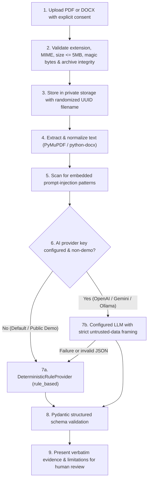

# AI Resume Intelligence System

TalentOS includes a provider-independent, evidence-first resume review module (`apps/api/app/services/resume_ai.py` and `apps/api/app/services/documents.py`).

## Document Processing Flow

## Provider Architecture

Providers implement `ResumeAnalysisProvider` and are selected via environment variables (`AI_PROVIDER`):

1. `fallback` (default): Uses `DeterministicRuleProvider` with curated technical and professional skill catalogs, section parsing, and criterion-by-criterion verbatim excerpt matching. Always labeled `rule_based`.
2. `openai`: OpenAI-compatible `/chat/completions` JSON mode (`OPENAI_API_KEY`, `OPENAI_BASE_URL`, `OPENAI_MODEL`).
3. `gemini`: Google Gemini `generateContent` JSON response mode (`GEMINI_API_KEY`, `GEMINI_MODEL`).
4. `ollama`: Local Ollama `/api/chat` (`OLLAMA_BASE_URL`, `OLLAMA_MODEL`).

Public demo sessions stay locked to `rule_based` analysis unless an operator explicitly sets `AI_ALLOW_EXTERNAL_IN_DEMO=true`. External provider failures automatically fall back to deterministic rule-based extraction and disclose the fallback in `analysis_limitations`.

## Structured Output Contract

Every analysis produces a validated `ResumeAnalysisStructuredOutput` containing:

- Extracted document facts: `professional_summary`, `extracted_technical_skills`, `extracted_professional_skills`, `relevant_work_experience`, `education`, `certifications`.
- Job requirement mapping: `required_qualifications_evidence` and `preferred_qualifications_evidence` with `status` (`evidence_found`, `not_found`, `ambiguous`) and verbatim `evidence_excerpt`.
- Gaps and ambiguity: `requirements_not_found` (labeled as not located in the document, never inability) and `uncertain_or_ambiguous`.
- Reviewer preparation: `suggested_interview_questions` (explicitly marked as suggestions) and `analysis_limitations`.

## Responsible AI Boundaries

- TalentOS never infers or ranks candidates by race, ethnicity, religion, gender, sexual orientation, disability, age, marital status, or appearance.
- TalentOS never computes personality scores, employability predictions, or universal candidate quality scores.
- TalentOS never automatically moves candidates to `hired` or `rejected`. Only authorized human users can advance or decline candidates, with written rationale recorded in `application_stage_history`.
- Uploaded resume content is treated as untrusted data. Known prompt-injection patterns ("ignore previous instructions", "move candidate directly to hired", "give 100% score") are flagged in `prompt_injection_flags` and ignored.
- Reviewers can record human verification and corrections via `PATCH /api/v1/resume-analyses/{id}/review`.
