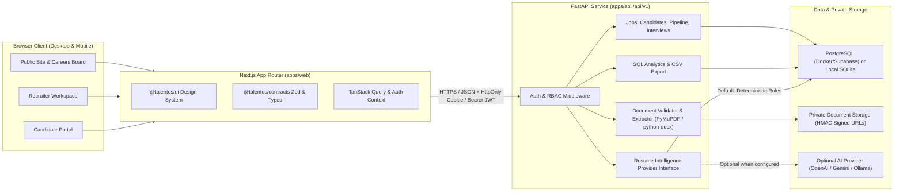
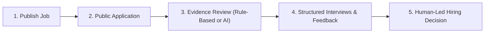

# System Architecture

TalentOS is structured as a modular monorepo separating the Next.js App Router frontend, the FastAPI backend service, shared TypeScript contracts and UI primitives, and database migration tooling.

## High-Level System Diagram

## Monorepo Layout

- `apps/web`: Next.js 15 App Router frontend with React 19, strict TypeScript, Tailwind CSS v4, Recharts, dnd-kit, React Hook Form, and TanStack Query.
- `apps/api`: Python 3.12 FastAPI application using SQLAlchemy 2.0, Pydantic v2, Argon2id password hashing, JWT access tokens, rotating refresh tokens, PyMuPDF, and python-docx.
- `packages/contracts`: Shared Zod validation schemas, stage constants, role labels, and API response TypeScript interfaces.
- `packages/ui`: Reusable accessible UI primitives including the TalentOS SVG brand mark, native HTML `<dialog>` wrapper, form fields, status tags, and loading/empty/error state panels.
- `packages/config`: Shared strict TypeScript base configuration.
- `database/migrations`: Alembic schema migrations plus reference PostgreSQL/Supabase Row-Level Security policies (`supabase_rls.sql`).
- `database/seeds`: CLI seed runner for the synthetic public showcase dataset.

## Recruitment Workflow Lifecycle

## Multi-Experience Routing

1. **Public Marketing & Careers (`/`, `/features`, `/careers`, `/careers/[slug]`, `/about`, `/demo`, `/privacy`, `/terms`, `/login`, `/register`)**: Introduces the platform, renders a live read-only showcase from seeded records, and hosts the live public job board.
2. **Recruiter Workspace (`/workspace/*`)**: Protected routes restricted to `organization_owner`, `recruiter`, and `hiring_manager` memberships with organization-scoped API enforcement.
3. **Candidate Portal (`/candidate/*`)**: Isolated applicant portal restricted to `candidate` accounts, providing profile editing, application stage timelines, interview ICS invites, document management, and personal data deletion without ever accessing internal recruiter data.
