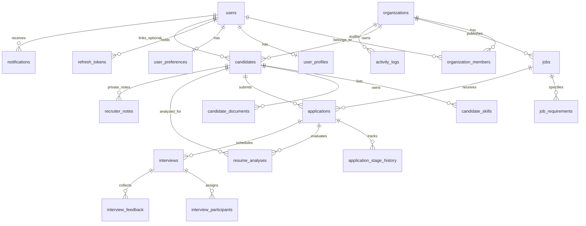

# Database Architecture

TalentOS uses a normalized relational schema managed with SQLAlchemy 2.0 and Alembic migrations (`database/migrations/`). Every table uses UUID primary keys, explicit foreign keys, created/updated timestamps, organization scoping where applicable, unique constraints, and targeted composite indexes.

The schema runs natively on **PostgreSQL 16** (Docker Compose, Supabase, Render, Railway) using `JSONB` variants and also supports a zero-Docker local **SQLite** fallback (`PRAGMA foreign_keys=ON`) for local development and automated testing.

## Entity Relationship Diagram



## Core Tables (20 Tables)

| Table | Purpose | Key Constraints & Indexes |
|-------|---------|---------------------------|
| `users` | Account credentials and identity | Unique `email`, index on `demo_session_id` |
| `refresh_tokens` | Hashed rotating refresh tokens | Unique `token_hash`, FK `users.id` cascade |
| `organizations` | Tenant boundary for hiring teams | Unique `slug`, indexes on `is_public_showcase`, `demo_session_id` |
| `organization_members` | Role assignments (`organization_owner`, `recruiter`, `hiring_manager`) | Unique `(organization_id, user_id)`, index `(organization_id, role)` |
| `user_profiles` | Candidate and user profile details + consent timestamp | Unique `user_id` |
| `user_preferences` | Theme and in-app notification settings | Unique `user_id` |
| `jobs` | Job specifications, salary bands, and status lifecycle | Unique `slug`, indexes `(organization_id, status)`, `(organization_id, department)` |
| `job_requirements` | Normalized required, preferred, and skill items | Index `(job_id, category)` |
| `candidates` | Organization-scoped applicant dossier | Unique `(organization_id, email)`, index `(organization_id, full_name)` |
| `candidate_skills` | Profile and resume-extracted candidate skills | Unique `(candidate_id, skill_name)`, index `(organization_id, skill_name)` |
| `candidate_documents` | Private metadata, SHA-256 hash, and extracted text | Index `(organization_id, candidate_id)` |
| `applications` | Candidate application per job and current stage | Unique `(job_id, candidate_id)`, indexes `(organization_id, stage)`, `(organization_id, applied_at)` |
| `application_stage_history` | Immutable stage transition audit trail for funnel analytics | Index `(application_id, changed_at)` |
| `resume_analyses` | Structured evidence output, mode, prompt-injection flags, human review | Index `(organization_id, candidate_id)` |
| `interviews` | Interview rounds, timestamps, links, and status | Indexes `(organization_id, scheduled_start)`, `(organization_id, status)` |
| `interview_participants` | Assigned interviewers and attendance | Unique `(interview_id, user_id)` |
| `interview_feedback` | Post-interview recommendation and rubric scores | Unique `(interview_id, reviewer_id)` |
| `recruiter_notes` | Private internal hiring-team notes | Index `(organization_id, candidate_id)` |
| `notifications` | Persistent per-user alerts | Index `(user_id, is_read, created_at)` |
| `activity_logs` | Organization audit trail | Index `(organization_id, created_at)` |

## Organization Isolation and Row-Level Security

- Every recruiter API query filters explicitly by `organization_id == auth.organization.id`.
- For PostgreSQL / Supabase deployments, `database/migrations/supabase_rls.sql` provides reference Row-Level Security policies enforcing tenant boundaries and blocking candidates from reading `recruiter_notes`.

## Running Migrations and Seeds

```bash
pnpm db:migrate
pnpm db:seed
```
